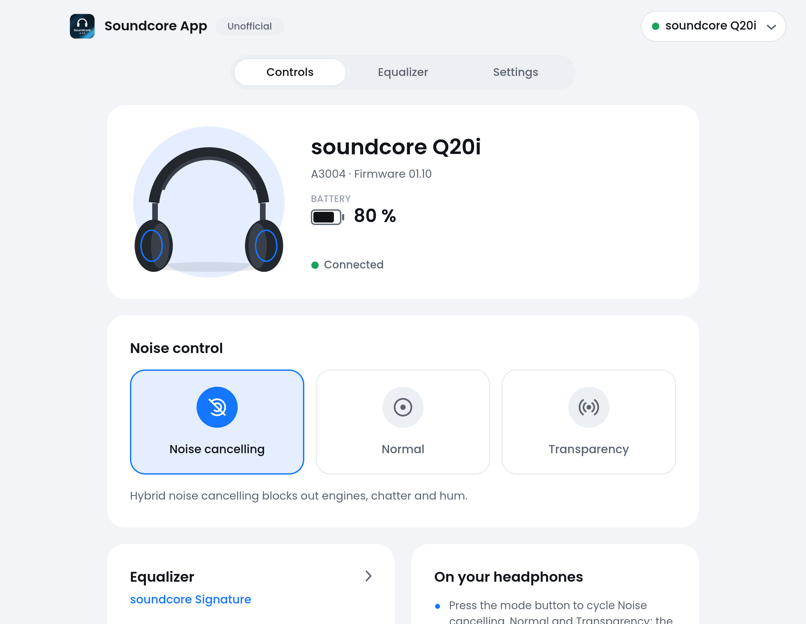
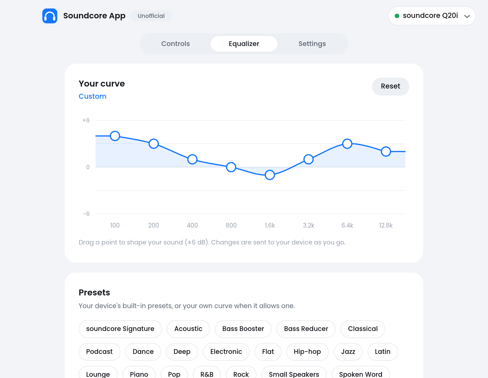
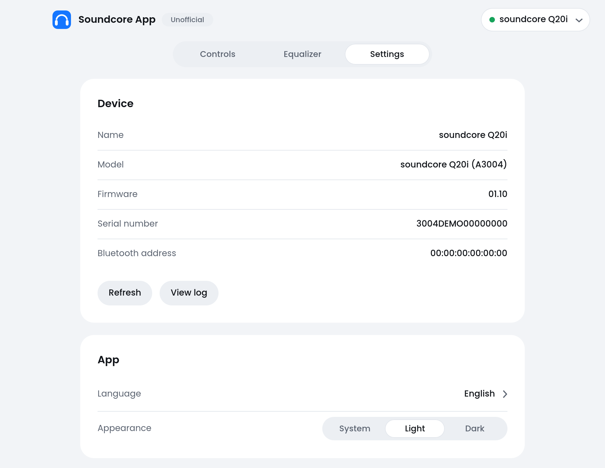
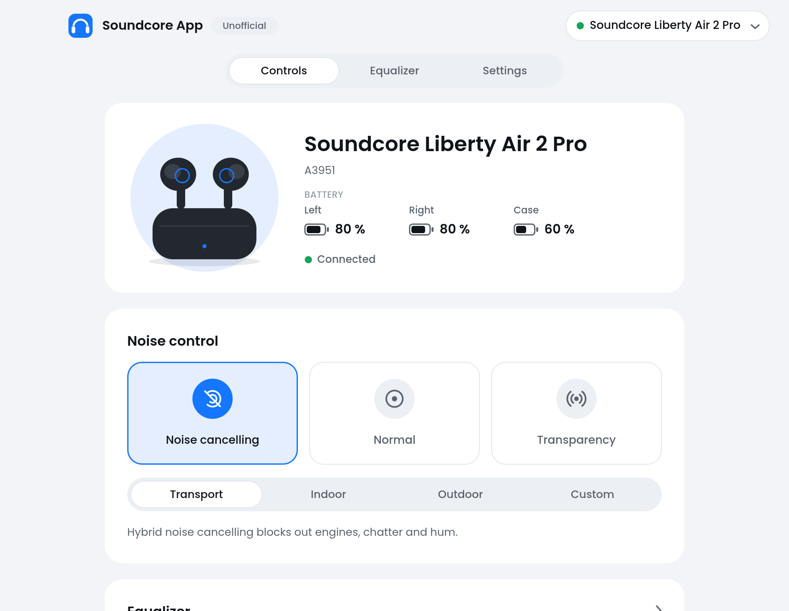
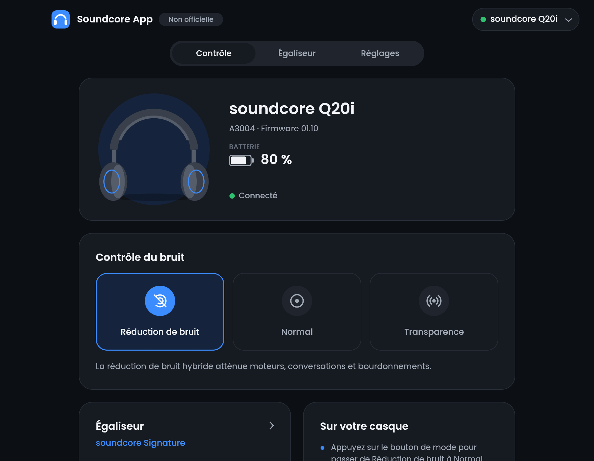

# Soundcore App for macOS (unofficial) — v1.1.2

A native macOS companion app, written in Rust, for **soundcore headphones and earbuds**. It knows about 40 soundcore products (see *Supported devices*), and other soundcore devices work through the commands they all share.
Its look takes after the headphones' own mobile app: a light, airy layout with white cards and one vivid blue. It also has a dark mode, and it runs in five languages.

> **Unofficial, non-certified app.** It is not developed, affiliated with, endorsed or certified by Anker Innovations or soundcore. Use it at your own risk.

| Controls | Equalizer | Settings |
|---|---|---|
|  |  |  |

| Earbuds | Dark mode (French) |
|---|---|
|  |  |

## Features

* **Battery**: headphones, or left and right earbuds plus the case, with charging indicators. Levels use each product's own scale.
* **Noise control**: noise cancelling, normal or transparency.
  * On products that offer it, you can also pick the noise cancelling flavour (transport, indoor, outdoor, custom) and the transparency flavour (full or voices).
  * Presses on the device's own buttons show up in the app straight away.
* **Equalizer**:
  * each product's own presets;
  * your own curve on 8 bands (100 Hz to 12.8 kHz, ±6 dB) where the product allows one. You drag the points on the graph, and changes reach the device as you drag.
* **Device details**: model, firmware, serial number and Bluetooth address.
* **My devices**: switch between paired headphones, or open the macOS Bluetooth settings to pair new ones.
* **Tips** on the headphones' own buttons and lights.
* **Languages**: English, French, Spanish, German and Italian. The app follows the macOS language by default.
* **Appearance**: System, Light or Dark.
* **Menu bar**: closing the window keeps the app running in the menu bar, with the battery and noise control one click away. *Open* brings the window back; *Quit* or ⌘Q quits.
* **Shortcuts**: ⌘1…⌘3 switch tabs; Esc closes a dialog.

## Compatibility

**macOS 11 Big Sur or later**, on Apple Silicon and Intel Macs (universal binary).

### Supported devices

The app identifies the product from its Bluetooth service, its name or its serial number. It then reads that product's state layout. Every layout was written from the protocol documented by OpenSCQ30. So far the app has only been tested in demo mode, not on real devices: please report what works.

| Level | Devices |
|---|---|
| Battery, noise control and equalizer (presets and your own curve) | Q20i (A3004), Life Q35 (A3027), Life Tune Pro (A3030), Life Q30 (A3028), Life Tune (A3029), Vortex (A3031), Life Dot 2 NC (A3931), Life A2 NC (A3935), Life Note 3 (A3933), Life P3 (A3939), P30i / R50i NC (A3959) |
| Battery and equalizer (these products have no noise control) | Q11i (A3005), Life 2 Neo (A3033), Life Note 3S (A3945), A20i (A3948), V20i (A3876), C30i (A3330), AeroClip (A3388), C50i (D1101); presets only: Life P2 Mini (A3944), P20i / P25i / R50i (A3949) |
| Battery and noise control; equalizer shown but not adjustable yet | Space One (A3035), Space Q45 (A3040), Space One Pro (A3062), Space 2 (D1402), Liberty 2 Pro+ (A3930), Liberty Air 2 Pro (A3951), Space A40 (A3936), Liberty 4 NC (A3947), Liberty 3 Pro (A3952), Liberty 4 (A3953), Liberty 4 Pro (A3954), P40i (A3955), Liberty 5 (A3957), Sport X20 (A3968), P31i / R60i NC (D1202) |
| Battery and details | Liberty 2 Pro (A3909), Life Dot 2S (A3926), Sleep A30 (D1301) |
| Any other soundcore device | Battery, firmware and serial number through the shared commands. Noise control and equalizer use the classic formats, and the app says the model isn't described yet. |

Speakers that use a different framing, such as the Motion+, are not supported.

## Install

**From the installer:** download `Soundcore-App-1.1.2.dmg` from the [Releases page](https://github.com/Abberate/soundcore-app-macos/releases/latest), open it and drag *Soundcore App* onto *Applications*. The installer window shows the steps, and *Lisez-moi - Read me.txt* gives the details in French and English.

* The app is not signed by an identified Apple developer, so macOS may block the first launch. Go to System Settings > Privacy & Security, click **Open Anyway** and confirm. On macOS 14 or earlier, right-click the app and choose **Open** instead.
* Allow **Bluetooth** access when macOS asks.
* The device must be paired with the Mac and connected as an audio device.
* **Only one app at a time can use the device's controls.** If the soundcore app is open on your phone, the Mac app explains it and connects as soon as the channel is free.

**From source** (needs Rust via `rustup` and the Xcode command-line tools):

```sh
scripts/bundle.sh       # → dist/Soundcore App.app (native architecture)
scripts/make_dmg.sh     # → dist/Soundcore-App-<version>.dmg (universal installer)
```

`make_dmg.sh` needs both macOS targets: `rustup target add x86_64-apple-darwin aarch64-apple-darwin`.

## CLI: `soundcorectl`

It ships inside `Soundcore App.app/Contents/MacOS/`. You can also run it with `cargo run --bin soundcorectl -- …`:

```sh
soundcorectl list
soundcorectl status | monitor
soundcorectl mode anc|normal|transparency
soundcorectl eq 17                     # preset id (0 = soundcore Signature … 21)
soundcorectl eq custom 3 2 1 0 0 1 2 3 # 8 gains in dB, −6…6
soundcorectl --device aa-bb-cc-dd-ee-ff status
```

## Demo mode and visual checks

```sh
cargo run -- --demo                                          # simulated soundcore Q20i
SOUNDCORE_DEMO=1 SOUNDCORE_DEMO_MODEL=A3951 cargo run         # any product in the table
SOUNDCORE_DEMO=1 SOUNDCORE_LANG=de SOUNDCORE_THEME=dark cargo run
SOUNDCORE_DEMO=1 SOUNDCORE_SCENE=eq cargo run
#   scenes: eq, custom, settings, devices, language, log, connect, waiting, busy, charging
SOUNDCORE_DEMO=1 SOUNDCORE_SCREENSHOT=/tmp/shot.png cargo run  # saves a screenshot, then quits
SOUNDCORE_DEMO=1 SOUNDCORE_CHECK_TEXT=1 cargo run              # reports text that had to shrink
```

Demo and test runs never write to your saved preferences.

## Architecture

```
crates/
  soundcore-protocol/  Pure protocol, no I/O, unit-tested: framing and checksum, reassembly,
                       typed requests and events, equalizer presets, a data table of ~40
                       products (capabilities and state layout), DeviceState
  soundcore-bt/        macOS transport: IOBluetooth through objc2 (SDP lookup of the vendor
                       service, RFCOMM channel, writes); `probe` example for diagnostics
  soundcore-app/       egui app (ui/: shell, pages, art, i18n, theme, widgets), session
                       engine, `soundcorectl` CLI, icon generator
```

* **Bluetooth threading.** IOBluetooth runs on top of CoreBluetooth, which delivers its callbacks on the main queue. Every IOBluetooth call is dispatched to the main thread through GCD, and the session engine runs on its own thread.
* **Product table.** Each product is described as data: its kind, noise control options, equalizer format, battery scales and the order of the fields in its state answer. One generic parser walks that layout.
* **Finding the service.** soundcore devices advertise a vendor RFCOMM service whose UUID ends with the product number (`0cf12d31-fac3-4553-bd80-d6832e7b3004` on the Q20i). The app reads it from the SDP cache, which also identifies the exact product.
* **Wire format.**
  * To the headphones: `08 ee 00 00 00 | command (2) | length (u16 LE) | body | sum`. From the headphones, the header is `09 ff 00 00 01`.
  * `length` counts the whole frame, and the last byte is the 8-bit sum of all the bytes before it.
  * Writes are acknowledged by an empty frame with the same command. Button presses and battery changes arrive as pushes.

## Credits and licences

* **Protocol:** documented by [OpenSCQ30](https://github.com/Oppzippy/OpenSCQ30) (Oppzippy, GPL-3.0). This app is an independent implementation built on that documentation. Thank you!
* **Code:** **GPL-3.0-or-later** (see `LICENSE`).
* **Font:** Poppins (SIL OFL 1.1).
* **Artwork:** the headphone illustration and the icons are original, drawn in code.
* *soundcore* and *Anker* are trademarks of Anker Innovations.
